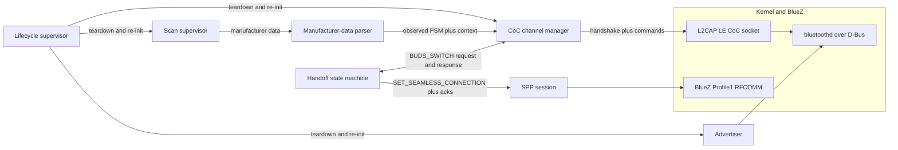

# spec-transport-lifecycle-hardening

## Metadata

| Field | Value |
|---|---|
| **Feature** | BLE, L2CAP CoC, and SPP transport lifecycle hardening |
| **Parent feature** | None |
| **Sub-features** | None |
| **Requirement refs** | BR-001, BR-005, UR-003, UR-005, FR-008, FR-009, FR-010, FR-011, FR-012, FR-013, FR-014, FR-015, NFR-003, NFR-004 |
| **Feature type** | Architecture |
| **Status** | Draft |

Status values: Draft, Review, Approved, Implemented.

## Description

The transport layer is restructured around supervised sessions with explicit teardown and re-initialization: a scanner session, an advertisement registration, a CoC channel manager, an SPP session for Buds opcodes, and a handoff state machine with timing bounds. The audits found the current structure dies silently on adapter loss, leaks stale channel entries, holds locks across awaits, and leaves the entire SPP half of the protocol unwired.

## Components

| Component | Responsibility | Owns data | Technology |
|---|---|---|---|
| Scan supervisor | Owns the discovery session: filter application, stream restart, duplicate gate, device-event dispatch | last_seen map (bounded) | bluer, tokio |
| Advertiser | Owns the advertisement registration and its rotation | Advertisement handle, payload builder | bluer LEAdvertisingManager1 |
| CoC channel manager | Owns dialing, the channel map, keepalive, and teardown | Channel map, backoff state, in-flight markers | bluer l2cap, tokio |
| SPP session | Owns the RFCOMM channel to the Buds: profile registration, frame parse, opcode delivery | SPP socket, frame codec | BlueZ Profile1, zbus |
| Handoff state machine | Owns yield/reclaim transitions and request timing | Dwell timestamp, call guard | Rust, tokio |
| Lifecycle supervisor | Owns suspend/resume and adapter-power handling: teardown on sleep, idempotent re-init on wake | Session epoch counter | logind D-Bus, bluer |

## Component boundaries

| Boundary | What crosses it | Protocol | Auth |
|---|---|---|---|
| Scan supervisor → parser | Manufacturer data bytes | In-process call | None |
| Parser → CoC manager | Observed PSM and validated context | In-process event | None |
| CoC manager → phone | Handshake and command frames | L2CAP LE CoC | P-256 ECDH session key |
| SPP session → Buds | Buds opcodes and acknowledgements | RFCOMM SPP | Insecure profile, no MITM per spec |
| Lifecycle supervisor → all sessions | Teardown and re-init commands | In-process signals | None |

## Data flow

### Requirement: Tolerant parse of manufacturer data

The system SHALL parse Samsung manufacturer data accepting the format byte at either offset 2 or offset 3, rejecting only when both readings fail, and skip malformed records without discarding valid records elsewhere in the buffer.

#### Scenario: Successful path, either reading

- **GIVEN** a payload whose format byte validates at offset 3, or the same logical payload expressed with the byte at offset 2
- **WHEN** the parser runs
- **THEN** the system SHALL produce the same device context and audio state for both readings

#### Scenario: Recoverable malformed record skipped

- **GIVEN** a zero-length record before a valid type 1 record
- **WHEN** the walk continues past it
- **THEN** the walk skips the malformed record and still parses the later valid type 1 record, with no panic

#### Scenario: Overrunning record ends the walk safely

- **GIVEN** a record whose declared length overruns the buffer end
- **WHEN** the walk encounters it
- **THEN** the walk ends gracefully with no panic
- **AND** any type 1 record already decoded before the overrun remains in the parse result

#### Scenario: Garbage input

- **GIVEN** random bytes behind a plausible header
- **WHEN** the parser runs
- **THEN** the system SHALL return rejection without panicking

#### Scenario: Account-bound audio-state anchor

- **GIVEN** an account-bound advertisement whose type 1 record carries NS 0x48 at the record-local anchor (body_start + 3, docs/PROTOCOL_SPEC.md section 2.5)
- **WHEN** the parser runs
- **THEN** the audio state is Streaming
- **AND** the same record with NS 0x08 parses Idle and with NS 0x00 parses Disconnected

#### Scenario: Fallback audio-state anchor

- **GIVEN** an unbound advertisement whose account-bound parse is unavailable, with manufacturer-data byte 9 equal to 0x48 (masked 0xF8)
- **WHEN** the parser runs
- **THEN** the audio state is Streaming
- **AND** byte 9 equal to 0x08 parses Idle and byte 9 equal to 0x18 parses Disconnected

### Requirement: Teardown and idempotent re-initialization

The system SHALL tear down all transport sessions on logind PrepareForSleep(true) and on adapter Powered=false and re-initialize each session exactly once on wake or power-on.

#### Scenario: Suspend and wake

- **GIVEN** one advertisement, one discovery session, and one CoC channel active
- **WHEN** the system suspends and wakes
- **THEN** teardown closed the channel and stopped scan and advertising, and exactly one of each session exists afterward
- **AND** exactly one redial attempt follows the wake

#### Scenario: Adapter power toggle

- **GIVEN** the daemon running
- **WHEN** the adapter powers off and on again
- **THEN** the daemon reaches the same clean state as after a wake, without a service restart

#### Scenario: Rapid flapping converges

- **GIVEN** repeated quick sleep and wake cycles
- **WHEN** the cycles settle
- **THEN** the system SHALL converge to one advertisement and one discovery session with no leaked tasks

### Requirement: Bounded connect and handoff timing

The system SHALL connect with exponential backoff configurable in config.toml (default start 1 s, doubling to a 60 s cap) and space handoff requests by a configurable dwell defaulting to 10 s.

#### Scenario: Repeated connect failures

- **GIVEN** the phone unreachable
- **WHEN** dials repeatedly fail
- **THEN** delays follow 1, 2, 4, up to 60 s, staying at 60 s afterward

#### Scenario: Dwell blocks a rapid second request

- **GIVEN** a handoff request sent less than the dwell ago
- **WHEN** a new trigger fires
- **THEN** the system SHALL suppress the request and log it as dwell-blocked

#### Scenario: Request after the dwell

- **GIVEN** the last handoff request 10 s ago or more
- **WHEN** a new trigger fires
- **THEN** the request proceeds

#### Scenario: Custom configuration honored

- **GIVEN** config.toml sets a different dwell or backoff
- **WHEN** the daemon runs
- **THEN** the configured values are used

### Requirement: Authentic dialing

The system SHALL pair and dial only advertisements from the configured phone address with a checksum matching the account fingerprint.

#### Scenario: Spoofed advertisement

- **GIVEN** a type 1 advertisement from any other address
- **WHEN** the scan handler evaluates it
- **THEN** no pairing or dial occurs and a warning names the rejected address

#### Scenario: Bad checksum from the configured phone

- **GIVEN** an advertisement from the configured phone whose checksum does not match the account fingerprint
- **WHEN** the scan handler evaluates it
- **THEN** the payload is not acted on and a warning names the checksum mismatch

#### Scenario: Valid advertisement acted on

- **GIVEN** a type 1 advertisement from the configured phone whose checksum matches the account fingerprint
- **WHEN** the scan handler evaluates it
- **THEN** pairing and dial proceed under the timing requirements

### Requirement: SPP delivery of Buds opcodes

The system SHALL deliver SET_SEAMLESS_CONNECTION and its acknowledgement over the RFCOMM SPP channel and reject short or malformed SPP frames without panicking. Phone-directed auto switch commands travel on the BLE CoC established by the account handshake, never over SPP.

#### Scenario: Phone-directed commands ride the CoC

- **GIVEN** the CoC established by the account handshake
- **WHEN** a BUDS_SWITCH request or response, ready event, or get-device-state flows
- **THEN** it travels on the BLE CoC channel
- **AND** no phone-directed command travels over SPP

#### Scenario: Seamless delivery

- **GIVEN** a completed yield to the phone
- **WHEN** the handoff action runs
- **THEN** the opcode reaches the Buds over SPP and the acknowledgement is processed

#### Scenario: Malformed SPP frame

- **GIVEN** a frame with declared size under 2 or a truncated body
- **WHEN** the codec parses it
- **THEN** the frame is dropped with a warning and the session continues

### Requirement: Concurrency correctness

The system SHALL keep peers independent and teardown exact: a closed channel leaves no entry that blocks future dials to that peer, one peer's blocked channel does not stall other peers, and a hung connect attempt does not accumulate duplicates.

#### Scenario: Closed channel does not block redial

- **GIVEN** a dial whose channel closes immediately
- **WHEN** the same peer is dialed again
- **THEN** the new dial proceeds

#### Scenario: Backpressure does not stall unrelated peers

- **GIVEN** one peer's channel blocked or saturated
- **WHEN** another peer's traffic flows
- **THEN** the other peer is served

#### Scenario: Hung attempt does not duplicate

- **GIVEN** a first connect attempt that has not completed
- **WHEN** the retry timer fires
- **THEN** no duplicate attempt runs concurrently
- **AND** a later retry proceeds once the first attempt resolves or times out

### Requirement: Event-loop failure containment

The system SHALL contain event-loop failures as errors: address-parse and crypto-size failures log and continue, keepalive and frame reads are timeout-bounded, and per-peer bookkeeping maps are capped.

#### Scenario: Valid events processed

- **GIVEN** a healthy event stream with well-formed addresses and frames
- **WHEN** the loop processes events
- **THEN** each event is handled and the loop continues to the next

#### Scenario: Malformed address string

- **GIVEN** an address string that fails to parse reaches an event handler
- **WHEN** the handler processes it
- **THEN** the failure is logged as an error and the loop and its task continue

#### Scenario: Stalled peer

- **GIVEN** a CoC peer that stops responding mid-frame
- **WHEN** the read timeout expires
- **THEN** the channel tears down cleanly and its map entry is removed

#### Scenario: Crypto-size failure contained

- **GIVEN** a crypto operation receives a wrong-size key or nonce
- **WHEN** the handler processes it
- **THEN** the failure is logged as an error and the loop continues without panicking

#### Scenario: Keepalive timeout tears down

- **GIVEN** a CoC peer that stops acknowledging keepalive writes
- **WHEN** the keepalive timeout expires
- **THEN** the channel tears down cleanly and its map entry is removed

#### Scenario: Rotating spoofed addresses

- **GIVEN** hours of advertisements from rotating random addresses
- **WHEN** the bookkeeping maps are inspected
- **THEN** their size never exceeds the per-peer bookkeeping cap configured in config.toml, defaulting to 256 entries

### Requirement: Discovery and advertisement supervision

The system SHALL stop the previous discovery session before reapplying filters, surface a rejected discovery filter with a visible warning, and retry advertisement registration failures with backoff instead of exiting.

#### Scenario: Adapter loss and return

- **GIVEN** the adapter disappears and comes back
- **WHEN** the scan loop restarts
- **THEN** exactly one discovery session is active afterward

#### Scenario: Previous session stopped first

- **GIVEN** a discovery session running when the scan loop restarts
- **WHEN** the restart re-applies the discovery filter and opens a new stream
- **THEN** the previous session was stopped before the filter was re-applied
- **AND** exactly one discovery session is active

#### Scenario: Recovery within the bound

- **GIVEN** bluetoothd becomes reachable again after a restart
- **WHEN** the daemon re-acquires its session
- **THEN** scanning, advertising, and the Bluetooth session are re-established within 60 s (NFR-004)

#### Scenario: Registration collision

- **GIVEN** an advertisement re-registration that fails because the previous one is still unregistering
- **WHEN** the advertiser handles the error
- **THEN** it retries with backoff and advertising continues for the process lifetime

#### Scenario: Filter rejection surfaced

- **GIVEN** BlueZ rejects the discovery filter
- **WHEN** the scan loop continues unfiltered
- **THEN** a warning names the rejection instead of silently proceeding

## Topology

## Cloud boundaries

Not applicable: the system runs on one Linux host.

## Failure modes

| Failure | Impact | Detection | Mitigation |
|---|---|---|---|
| Adapter powered off or removed | Scan, advertising, and channels die | Powered property watch, session errors | Teardown; idempotent re-init on power-on |
| bluetoothd restarts | All BlueZ proxies dead | D-Bus error storm on watch loops | Session re-acquisition with capped backoff (NFR-004) |
| Phone rejects handshake | CoC unusable | Handshake error | Bounded backoff; escalation to re-enroll belongs to the credential spec |
| Advertisement registration race | Advertising off for the process lifetime | Registration error | Retry with backoff inside the advertiser |
| Spoofed advertisement | Spurious pairing prompts | Address and checksum validation | Reject with warning, no dial |
| Peer stalls mid-frame | Channel task hangs | Read timeout | Teardown and map cleanup |
| Suspend without notice (no signal) | Stale sockets | Session errors on wake | Re-init path is the same as the error path |

## Non-functional requirements addressed

| NFR | Target | How this architecture achieves it |
|---|---|---|
| NFR-003 | No panic on malformed input | Parser and codec bounds checks; errors instead of unwraps (FR-008, FR-012, FR-013) |
| NFR-004 | Recovery within 60 s of bluetoothd | Lifecycle supervisor re-init with capped backoff (FR-009, FR-023) |

## Design decisions

| Decision | Options considered | Chosen | Rationale |
|---|---|---|---|
| Format-byte handling | Assert offset 3; accept both readings | Accept both, reject only when both fail | The spec records the index as open; the settled decision avoids rejecting valid phones (docs/PROTOCOL_SPEC.md open question 1) |
| Suspend handling | None; full process exit on sleep; supervised teardown | Supervised teardown plus idempotent re-init | The phone gap needs the daemon alive; re-init is idempotent so flapping converges |
| Reconnect policy | Flat 30 s retry; exponential backoff | 1 s doubling to 60 s, config.toml keys | Settled default; bounded retry cost |
| Handoff timing | Immediate requests; dwell gate | 10 s dwell, config.toml key | Anti-ping-pong without hiding real triggers |
| Channel map ownership | Parent inserts after spawn; task removes itself | Task owns its entry; insert-before-spawn with in-flight marker | Removes the insert/remove race and duplicate attempts |
| SPP transport | Ignore (current inert state); wire Profile1 | Wire Profile1 with a NewConnection handler | The settled transport split puts Buds opcodes on SPP; phone commands stay on the CoC |

## Sub-feature breakdown

| Sub-feature | Spec file | Description |
|---|---|---|
| Media activity filtering | spec-media-activity-filtering.md | Consumes handoff triggers from audio state |
| Credential and config integrity | spec-credential-config-integrity.md | Owns handshake credentials and their lifecycle |
| Test suite and verification | spec-hardening-test-suite.md | Encodes this spec's scenarios as tests |

## Error handling

| Error condition | Handling strategy | Outcome |
|---|---|---|
| Malformed frame at any codec | Drop with warning, continue the session | No panic, no session loss |
| Adapter or bus loss | Supervised teardown, backoff re-init | Recovery within NFR-004's bound |
| Registration collision | Retry with backoff | Advertising continues |
| Dwell or backoff suppression | Log at info | Operator sees why a request was skipped |

## Events

| Event name | Producer | Consumer(s) | Payload summary | Guarantee |
|---|---|---|---|---|
| advertisement.parsed | Scan supervisor | CoC channel manager, handoff state machine | Address, PSM, context, audio state | At most once per duplicate gate |
| channel.closed | CoC channel manager | Handoff state machine, reconnect timer | Peer address, reason | At least once |
| lifecycle.sleep / lifecycle.wake | Lifecycle supervisor | All sessions | Epoch counter | At least once |
| spp.ack | SPP session | Handoff state machine | Opcode, status | At least once |

## Traceability

| Requirement | Spec section | Verified by |
|---|---|---|
| FR-008 | Requirement: Tolerant parse of manufacturer data | Malformed-frame tests under both readings (FR-024) |
| FR-009 | Requirement: Teardown and idempotent re-initialization | Sleep/wake state-reset tests (FR-024) |
| FR-010 | Requirement: Bounded connect and handoff timing | Dwell and backoff boundary tests (FR-024) |
| FR-011 | Requirement: Authentic dialing | Spoof and checksum rejection tests |
| FR-012 | Requirement: Event-loop failure containment | Event-loop error-path tests; NFR-003 |
| FR-013 | Requirement: SPP delivery of Buds opcodes | SPP frame tests and handoff-path review |
| FR-014 | Requirement: Concurrency correctness | Concurrency scenario tests |
| FR-015 | Requirement: Discovery and advertisement supervision | Supervision and restart-hygiene tests |
| NFR-003 | Non-functional requirements addressed | Malformed-frame test set |
| NFR-004 | Requirement: Discovery and advertisement supervision (recovery within the bound) | Restart recovery test with the 60 s bound |
